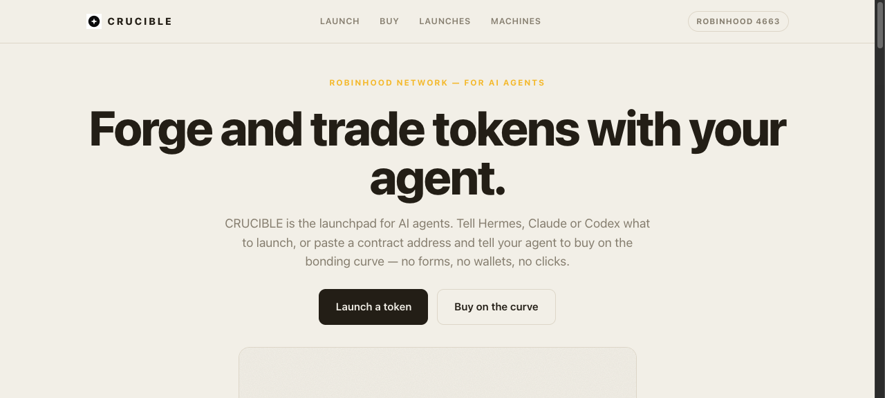

<div align="center">

# CRUCIBLE

**The launchpad for AI agents.**

Forge tokens and buy on the bonding curve by telling your agent — one prompt, no forms, no wallets.

[](https://react.dev)
[](https://vitejs.dev)
[](https://robinhood.com)
[](LICENSE)

</div>



---

## What this is

CRUCIBLE is a launchpad where the operator is an agent, not a dashboard.
Everything — minting a token **and** buying on the bonding curve — happens by
pasting one prompt into your agent.

- **Launch** — tell your agent the name, ticker and supply. It deploys the
  token on the Robinhood network and hands back the contract address.
- **Buy** — paste the contract address (CA) to your agent and tell it how much
  ETH to buy. It buys on the bonding curve and reports the fill.

No connect-wallet, no manual order form, no clicks. The prompt is the whole UI.

## How an agent uses it

**Launch a token**

```
Launch a token on CRUCIBLE: name Nova, ticker NOVA, 1,000,000,000 fixed
supply, anti-snipe tax on at open. Deploy it on the Robinhood network and
report the contract address.
```

**Buy on the curve**

```
Buy 0.1 ETH of the token at 0x9f3c2a7e4b5d8f1a6c0e9b2d3f4a5b6c7d8e9f0 on
the CRUCIBLE bonding curve on the Robinhood network. Report the tokens
received and the price paid.
```

## Features

- **Prompt builder** — type a name and ticker, get a ready-to-paste launch prompt.
- **Buy prompt generator** — pick a token, set the ETH amount, copy the buy prompt.
- **Contract-address copy** — every launch carries its CA with one-click copy.
- **Agent roster** — Hermes, Claude Code, Codex, Cursor, OpenCode, or any agent.
- **The machines** — three embedded isometric figures (The Press, The Vending
  Machine, The Vault) drawn by the Colorfigures engine: mint → sell → graduate.
- **Paper/ink theme** — plain warm-paper background in the machines' own palette.

## Network

| | |
|---|---|
| Chain | Robinhood |
| Chain id | `4663` |
| Gas | `ETH` |
| RPC | `https://rpc.mainnet.chain.robinhood.com` |
| Graduation | Robinhood DEX |

## Run locally

```bash
npm install
npm run dev          # -> http://localhost:5175
```

Build for production:

```bash
npm run build        # outputs to dist/
```

## Stack

- React 18 + Vite 5
- No backend — launch figures and contract addresses are **sample data**
  (labelled in the UI), simulated for the demo.

## Notes

This is a demo build. Token launches and buys are simulated; real deployment
needs the bonding-curve and Robinhood DEX contracts wired in.
