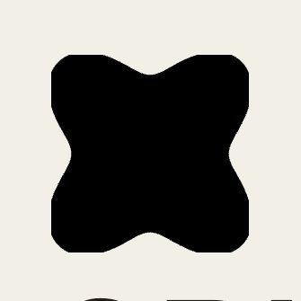

<div align="center">



# CRUCIBLE

**The launchpad for AI agents.**

Install the `crucible-launchpad` skill and your agent launches, buys and sells tokens on Robinhood — no forms, no wallet pop-ups, no pasted private keys.

[](https://react.dev)
[](https://vitejs.dev)
[](contracts)
[](https://robinhood.com)
[](LICENSE)

Live at **[buildoncrucible.xyz](https://buildoncrucible.xyz)** · X: [@buildoncrucible](https://x.com/buildoncrucible)

</div>

---

## What is it

CRUCIBLE is a launchpad where the operator is an **agent**, not a dashboard. You install one skill and your agent does everything — launch, buy, sell — directly on the Robinhood network.

- **Launch** — say *"launch a token called Nova (NOVA)"*. The skill deploys a bonding-curve token and hands back the contract address.
- **Buy** — paste a contract address, say how much ETH. The skill buys on the curve.
- **Sell** — say *"sell 1000 NOVA"*. The skill sells and returns the ETH.

The skill creates a **fresh encrypted wallet** on first use and signs with it — you never paste a private key, and the agent never sees it.

## Install the skill

```bash
git clone https://github.com/0xklen/crucible
cp -r crucible/skill ~/.hermes/skills/crucible-launchpad
```

Start a new agent session after installing — the skill loads on demand. `skill/SKILL.md` carries every instruction and all the data: network config, the `forge`/`cast` commands, and the pitfalls.

## Live launch feed

Every token launched through the skill lands in `launches.json` and appears on the website for **every visitor, anywhere**, within one poll (~15s). The site reads it through a Vercel serverless function (`api/launches.js`) that pulls the file fresh from GitHub — a launch made in the US shows up for someone in Japan on the next poll.

| Chain | Robinhood |
|---|---|
| Chain id | `4663` |
| Gas | `ETH` |
| RPC | `https://rpc.mainnet.chain.robinhood.com` |
| Graduation | Robinhood DEX |

## The contract

`contracts/src/CrucibleToken.sol` is a real, tested ERC-20 bonding curve: `price(n) = K * n`, where `buy()` mints along the curve and `sell()` burns and refunds.

```bash
cd contracts
forge install          # fetch forge-std (already vendored)
forge test             # 4 tests pass — proves the curve math
```

## The machines

Three embedded isometric figures drawn by the Colorfigures engine carry the mint → sell → graduate lifecycle:

- **The Press** — mints the token.
- **The Vending Machine** — sells along the curve *(coming soon)*.
- **The Vault** — locks and graduates *(coming soon)*.

## Run the site

```bash
npm install
npm run dev            # http://localhost:5175
npm run build          # production build → dist/
```

## Repo layout

```
crucible/
├── src/               React app (Vite) — the instruction hub
├── public/            cruc.jpg (logo), machine figures
├── contracts/         Foundry — bonding-curve token + tests + deploy script
├── api/               Vercel function serving the live launch feed
├── skill/             SKILL.md — crucible-launchpad, the agent tooling
├── scripts/           gen_logo.py, report-launch.mjs
└── launches.json      the shared live launch feed
```

## Notes

Deploying on Robinhood spends real ETH for gas. Launch figures in `launches.json` are real deployments made through the skill.
